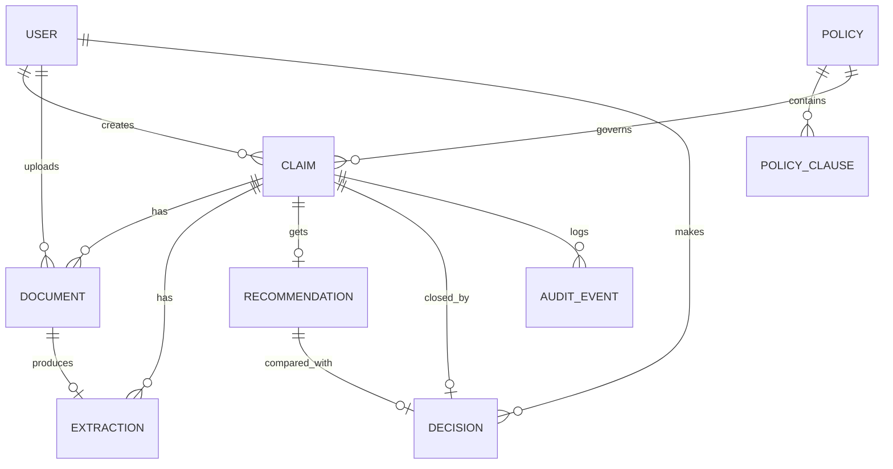

# Schema



| Table | Purpose |
| --- | --- |
| `user` | Login identity; `role` is `adjuster` or `admin` |
| `policy`, `policy_clause` | Policy versions and their clauses, each with a stable `clause_id` (indexed in Qdrant in Phase 2) |
| `claim` | The case; `status` follows the state machine in `backend/app/states.py` |
| `document` | Uploaded file metadata; bytes live in S3 under `s3_key`, integrity via `sha256` |
| `extraction` | Typed fields pulled from a document (filled by the Phase 3 agent) |
| `recommendation` | AI outcome, rationale and cited clause IDs (Phase 3) |
| `decision` | Human outcome. Stores `overridden`, `reason_code` and a link to the recommendation, so override rate is a query over this table |
| `audit_event` | Append-only log. `id` is an identity column, so ordering is exact even within one transaction |

## Append-only audit log

Migrations run as the schema owner (`claimpilot`). The API connects as `claimpilot_app`, which has `SELECT` and `INSERT` on `audit_event` and nothing else. `UPDATE`, `DELETE` and `TRUNCATE` fail with `permission denied`, and `tests/test_audit_append_only.py` proves it. Any migration that adds a table must grant privileges to `claimpilot_app` explicitly.

## Claim state machine

```
RECEIVED -> EXTRACTED -> ANALYZED -> AWAITING_ADJUDICATION -> APPROVED | DENIED | ESCALATED
   any of the first three -> NEEDS_REVIEW -> AWAITING_ADJUDICATION or a terminal state (human)
```

Terminal states are reachable only by a human actor through `POST /claims/{id}/decisions`. An illegal move returns 409 and writes nothing.
